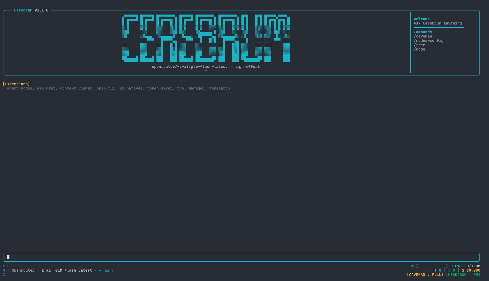

# Custom Pi Agent Configuration

Personal setup for [Pi](https://pi.dev) with custom extensions, themes, modes, and keybindings.



## Included Extensions
- **agent-modes**: Switch agent modes and granular permission constraints.
- **ask-user**: Context gathering tool. Prompts user for input to questions during execution.
- **context-viewer**: View and inspect context and tokens.
- **open-tui**: Custom full-screen TUI layout and widgets (Copied from open-tui extension on pi marketplace).
- **pi-natives**: Native utilities integration.
- **token-saver**: Headroom and caveman token optimization tool.
- **tool-manager**: Enable and disable agent tools dynamically.
- **websearch**: Custom web search integration (Searxng).

## Installation

### Method A: Direct Clone (Recommended for new machine)
```bash
git clone <your-repo-url> ~/.pi/agent
cd ~/.pi/agent
./install.sh
```

### Method B: Separate Directory Clone
```bash
git clone <your-repo-url> ~/pi-config
cd ~/pi-config
./install.sh
```

## Configure API Keys
Edit `~/.pi/agent/auth.json`:
```bash
chmod 600 ~/.pi/agent/auth.json
```
Fill in your provider API keys.
